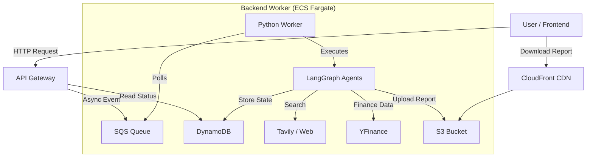

# Agentic Market Research Team

A virtual autonomous research team powered by AI agents. This application allows users to submit complex market research queries, which are then processed by a specialized team of agents (Supervisor, Researcher, Scout, Quant, Writer, Reviewer) to produce comprehensive PDF reports.

## 🏗 Architecture

The project follows a serverless and containerized architecture on AWS, designed for scalability and parallel processing.



### Key Components

-   **Frontend**: Next.js (React) application with a modern, responsive UI using TailwindCSS and Framer Motion. Real-time updates via polling.
-   **Backend API**: AWS API Gateway (v2) backed by AWS Lambda functions (Python/FastAPI-style handlers) for submitting tasks and checking status.
-   **Worker Service**: Python application running on AWS ECS (Fargate) that processes research tasks in parallel. It uses `LangGraph` to orchestrate a multi-agent workflow.
-   **Infrastructure**: Fully defined in Terraform (IaaC).

## 🤖 Agent Workflow

1.  **Supervisor**: Analyzes the query and delegates tasks.
2.  **Researcher**: Searches the web for information.
3.  **Scout**: Looks for specific data points or resources.
4.  **Quant**: Analyzes financial data if relevant.
5.  **Writer**: Compiles findings into a draft.
6.  **Reviewer**: critiques the draft and requests revisions if needed.
7.  **Final Output**: A professional PDF report.

## 🛠 Technology Stack

### Frontend
-   **Framework**: Next.js 15 (App Router)
-   **Language**: TypeScript
-   **Styling**: TailwindCSS, Lucide React (Icons)
-   **Animations**: Framer Motion
-   **State Management**: React Hooks + Local Storage persistance

### Backend
-   **Runtime**: Python 3.11
-   **Orchestration**: LangChain & LangGraph
-   **AI Models**: Grok 4.3 via xAI (OpenRouter)
-   **Tools**:
    -   `Tavily`: Web search and content extraction
    -   `YFinance`: Stock market data
    -   `BeautifulSoup`: Web scraping
    -   `xhtml2pdf`: PDF Generation

### Infrastructure (AWS)
-   **Compute**: ECS Fargate (Worker), Lambda (API), CloudFront (Frontend hosting)
-   **Storage**: S3 (Reports & Artifacts), DynamoDB (Task State)
-   **Messaging**: SQS (Task Queue)
-   **IaC**: Terraform
-   **Local Dev**: Docker Compose, LocalStack (AWS Emulator)

## 📂 Project Structure

```text
.
├── backend/                # Python backend application
│   ├── app/                # Main application logic
│   │   ├── agents/         # Agent definitions (prompts, nodes)
│   │   ├── graph/          # LangGraph workflow definition
│   │   └── worker.py       # Main worker entrypoint
│   └── lambdas/            # AWS Lambda handlers
├── frontend/               # Next.js frontend application
│   ├── src/app/            # App Router pages and components
│   └── public/             # Static assets
├── infrastructure/         # Terraform configuration
│   ├── ecs/                # ECS Fargate definitions
│   ├── lambda/             # Lambda function definitions
│   └── ...                 # Other modules (vpc, s3, sqs, etc.)
├── local-dev/              # Local development setup
│   ├── docker-compose.yml  # Local stack configuration
│   └── local_api_gateway.py # Local API emulator
└── scripts/                # Utility scripts
```

## 🚀 Getting Started

### Prerequisites

-   **Docker** & **Docker Compose**
-   **Node.js** (v18+)
-   **Python** (v3.11+)
-   **Terraform** (for deployment)
-   **AWS CLI**

### Environment Variables

Create a `.env` file in the root or specific directories as needed. Key variables:

-   `OPENROUTER_API_KEY`: Your OpenRouter API key
-   `TAVILY_API_KEY`: Your Tavily Search API key

### 💻 Running Locally

We use `docker-compose` and `LocalStack` to emulate the AWS environment locally.

1.  **Start the Local Environment**:
    ```bash
    ./start-local.sh
    ```
    This script will:
    -   Start LocalStack (S3, SQS, DynamoDB).
    -   Build and run the Backend Worker container.
    -   Start a local API Gateway emulator (port 8080).
    -   Initialize local resources (buckets, tables).

2.  **Start the Frontend**:
    Open a new terminal:
    ```bash
    cd frontend
    npm run dev
    ```
    Access the UI at: `http://localhost:3000`

### ☁️ Deployment

The project is deployed using Terraform.

1.  **Initialize Terraform**:
    ```bash
    cd infrastructure
    terraform init
    ```

2.  **Plan & Apply**:
    ```bash
    terraform apply
    ```
    *Note: Ensure you have your AWS credentials configured.*


